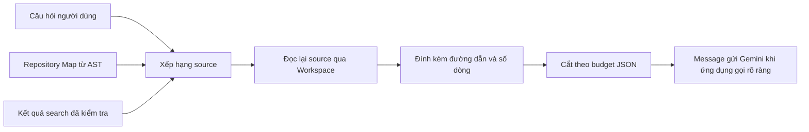

# Hướng dẫn hiểu phần core AI và Context Builder

## 1. Phần nào đang quyết định điều gì?

Trong Phase 2, Harness chọn dữ liệu cần đưa cho Gemini bằng thuật toán tĩnh. Gemini nhận context để suy luận và trả lời. Chưa có huấn luyện mô hình, gọi tool tự động bởi LLM hoặc Agent Loop.



Bạn nên đọc code theo thứ tự:

1. `tools/workspace.py`: xác định file nào được phép đọc và giới hạn đọc.
2. `tools/search.py`: dùng ripgrep trên văn bản đã kiểm tra, trả references.
3. `context/repository_map.py`: dùng AST lấy package, module, class, function và số dòng.
4. `context/builder.py`: chọn source, tạo excerpt, giới hạn context và xuất message.

## 2. Relevance được tính như thế nào?

`terms()` tách từ và chuyển chữ thường. Mỗi file được tính điểm:

| Tín hiệu | Điểm |
|---|---|
| Một từ trong câu hỏi trùng từ trong đường dẫn | +3 |
| Một từ trùng tên symbol | +5 cho mỗi symbol có từ đó |
| File xuất hiện trong kết quả search được truyền vào | +10 |

Điểm cao được chọn trước; bằng điểm thì sắp theo đường dẫn để kết quả ổn định. File không có tín hiệu liên quan không được lấy tùy ý. Ví dụ câu hỏi `Giải thích Login.authenticate` sẽ ưu tiên file có symbol `Login.authenticate` dù tên file chỉ là `auth.py`.

Kết quả search là một đầu vào của builder, do ứng dụng gọi rõ ràng. Builder không tự yêu cầu Gemini quyết định gọi search. Relevance hiện là trùng từ; chưa hiểu từ đồng nghĩa hoặc ý nghĩa sâu của câu hỏi. Các trọng số là heuristic đơn giản và có test cho hành vi, chưa phải kết quả tối ưu qua benchmark.

## 3. Source references và kiểm tra lại dữ liệu

Repository Map chứa đường dẫn, loại package/module, tên class/function và dòng bắt đầu/kết thúc. AST chỉ phân tích cú pháp, không import module. Lệnh nằm ở cấp module cũng không được thực thi.

Builder không tin nguyên văn metadata hoặc snippet do caller truyền vào. Nó dựng lại map từ các đường dẫn được phép, đọc source qua Workspace và lấy nội dung thực tế. Source được đính kèm `path`, `start_line`, `end_line` và cờ `truncated`.

Dòng trọng tâm ưu tiên reference từ search; nếu không có, dùng dòng symbol phù hợp. Mỗi excerpt lấy tối đa 30 dòng, bắt đầu trước dòng trọng tâm tối đa 3 dòng. Dòng được tính theo ký tự xuống dòng LF; CRLF/CR được chuẩn hóa trong bộ nhớ, không sửa file.

## 4. Budget hoạt động ra sao?

Budget tính bằng **số ký tự của JSON đã serialize**, qua `len(context.model_dump_json())`. Đây không phải token budget của Gemini. `context.to_message()["content"]` chính là JSON đó, gồm câu hỏi, map, source và chỉ dẫn xử lý repository như dữ liệu không đáng tin.

Map được giới hạn riêng và dành tối đa khoảng một phần ba context budget. Builder bỏ bớt module nếu phần nền quá lớn. Excerpt được rút ngắn bằng cách bỏ dòng ở biên xa dòng trọng tâm nhất; dòng trọng tâm được giữ lại. Chỉ khi riêng dòng đó vẫn không vừa mới lấy prefix và đặt `partial_line=true`; lúc đó `start_line=end_line` là số dòng thực tế. Mọi lần cắt đều có cờ `truncated`. Nếu riêng câu hỏi và metadata cần thiết vẫn không vừa, trả lỗi `CONTEXT_BUDGET_EXCEEDED`, không âm thầm sửa câu hỏi hoặc bỏ mất thông tin thiếu dữ liệu.

Khi `partial_line=false`, nội dung tương ứng các dòng đầy đủ từ `start_line` đến `end_line` của văn bản đã chuẩn hóa newline, không tính ký tự kết thúc dòng cuối. Khi `partial_line=true`, nội dung chỉ là prefix của một dòng, không được diễn giải như dòng đầy đủ.

Map và context có `incomplete` được tính từ cờ cắt, lý do và số đếm. Kết quả không có source nhưng `incomplete=false` khác với kết quả rỗng do không khám phá đủ. `reasons` dùng tối đa 15 mã cố định, chẳng hạn `scan_limit`, `read_error`, `map_budget`, `context_budget`, `source_limit`, `deadline`. Không chứa path hoặc thông báo lỗi của nguồn bị từ chối.

Map giữ `skipped`, `scan_skipped`, `syntax_errors`. Context giữ `input_map_skipped`, `input_map_syntax_errors` từ map ban đầu, cùng `skipped_sources`, `scan_skipped`, `omitted_sources` của quá trình dựng context. `scan_skipped` đếm các lần entry không dùng được, không phải số file duy nhất. `omitted_sources` chỉ đếm các ứng viên đã xếp hạng nhưng không được đính kèm; không thể suy ra số nguồn chưa được duyệt do scan limit. File rỗng được đọc thành công không bị tính là nguồn lỗi.

Metadata được giữ khi rebuild map, kể cả khi nguồn bị bỏ qua không còn xuất hiện trong danh sách module. Metadata cũng nằm trong JSON budget. Map không đủ chỗ cho metadata trả `MAP_BUDGET_TOO_SMALL`; context trả `CONTEXT_BUDGET_EXCEEDED`. Nếu không chọn được source, caller cần xem `incomplete`, `reasons` và các số đếm trước khi kết luận không có nội dung liên quan.

## 5. Dùng API hiện có

Phase 2 cung cấp API Python. CLI Phase 1 vẫn là giao diện trò chuyện; chưa thêm lệnh khám phá repo vào CLI.

```python
from codepilot.config import load_config
from codepilot.context.builder import ContextBuilder
from codepilot.context.repository_map import RepositoryMapper
from codepilot.tools.factory import create_read_only_registry
from codepilot.tools.workspace import Workspace

config = load_config()
workspace = Workspace(config.repository)
registry = create_read_only_registry(config.repository)

result = registry.call("search_code", {"query": "authenticate"})
if not result.ok:
    raise RuntimeError(result.error)

mapping = RepositoryMapper(workspace).build()
context = ContextBuilder(workspace).build(
    "Giải thích Login.authenticate",
    mapping,
    result.data["matches"],
)
message = context.to_message()
print(len(message["content"]))
for source in context.sources:
    print(source.path, source.start_line, source.end_line, source.truncated)
```

Ví dụ trên không gọi Gemini và không in toàn bộ source hoặc cấu hình. Ứng dụng có thể gọi `GeminiProvider.generate([message])` một cách rõ ràng khi cần, rồi đóng provider trong `finally`. Lượt triển khai Phase 2 không tiêu thụ Gemini quota để kiểm chứng logic chọn context.

Các tool được đăng ký duy nhất là `list_files`, `read_file`, `search_code`. Logger ứng dụng ghi event cố định cho lần gọi, thành công hoặc lỗi; không ghi query, đường dẫn, nội dung source hay raw exception. Kết quả có `ok`, `data`, `error`. Tên tool lạ trả `UNKNOWN_TOOL`; tham số sai trả `INVALID_ARGUMENTS`. Lỗi không chứa raw exception hay đường dẫn/giá trị đầu vào.

## 6. Cấu hình và giới hạn mặc định

Đặt các trường trong bảng `[repository]` của `codepilot.toml`, hoặc ghi đè qua `CODEPILOT_REPOSITORY_<TÊN_TRƯỜNG>`. Workspace tương đối được tính từ thư mục làm việc của tiến trình; nên dùng đường dẫn tuyệt đối khi gọi API từ vị trí khác.

| Trường | Mặc định | Ý nghĩa |
|---|---|---|
| `workspace` | `.` | Root được phép khám phá |
| `max_file_bytes` | 131072 | Tối đa 128 KiB mỗi file |
| `max_files` | 1000 | Số file mỗi lượt duyệt |
| `max_scan_entries` | 10000 | Số entry filesystem được xét |
| `max_depth` | 20 | Giới hạn độ sâu đường dẫn khi duyệt |
| `max_total_bytes` | 4194304 | Tổng dữ liệu văn bản mỗi bước map/search/chọn source |
| `max_output_chars` | 32000 | Giới hạn JSON ToolResult trả ra |
| `max_map_chars` | 16000 | Giới hạn JSON Repository Map |
| `max_context_chars` | 32000 | Giới hạn JSON Context |
| `max_context_files` | 8 | Số excerpt tối đa |
| `max_symbols` | 2000 | Số symbol AST tối đa |
| `max_search_results` | 100 | Số dòng match tối đa |
| `timeout_seconds` | 5 | Deadline từng bước và timeout còn lại cho ripgrep |

Search gọi ripgrep một lần trên input rỗng để kiểm tra query, sau đó một lần cho mỗi file văn bản hợp lệ, dùng stdin. `rg` không được mở file repository. Tiến trình dùng engine regex mặc định, `--no-config`, không shell và không kế thừa API key qua environment. Đường dẫn executable nằm trong workspace bị từ chối.

Output tạm của mỗi tiến trình được chặn về độ lớn bởi kích thước input file và số dòng match; output trả cho caller còn chịu giới hạn JSON. Snippet tối đa 512 ký tự quanh vị trí match. Khi thiếu `rg`, trả `RIPGREP_UNAVAILABLE`; không chạy lệnh shell thay thế. Khi hết thời hạn, trả `SEARCH_TIMEOUT`, không trả kết quả giả là đầy đủ.

## 7. Ranh giới bảo mật cần giải thích đúng

- Từ chối đường dẫn tuyệt đối, drive/UNC, `..`, NTFS stream và alias kết thúc bằng dấu chấm/khoảng trắng.
- Từ chối mọi symlink/junction và file hardlink, kể cả link nội bộ; cách này đơn giản hơn việc cho phép một số link.
- Loại `.git`, `.venv`, cache, `.env*`, thư mục/tên credential và định dạng private key đã định nghĩa trong policy.
- Từ chối nội dung giống credential, private key và literal nhạy cảm theo mẫu; dữ liệu test hoàn toàn tổng hợp.
- Chỉ nhận UTF-8/UTF-8 BOM và text không có dấu hiệu binary. File encoding khác, quá lớn hoặc không đủ quyền trả lỗi an toàn.
- Không ghi vào repository mục tiêu và không thực thi source. Ripgrep là công cụ tin cậy được cài bên ngoài workspace.

Bộ lọc secret là phòng vệ theo mẫu, có thể bỏ sót dạng bí mật chưa biết hoặc từ chối nhầm file hợp lệ. Không coi đây là bằng chứng mọi prompt đều không thể có secret. Map/context không phải snapshot nguyên tử khi tiến trình khác đồng thời sửa repository. Kiểm tra path và inode giúp chặn nhiều race thông thường, nhưng chưa phải chứng minh chống mọi thay đổi filesystem đối kháng. Không cam kết chống mọi prompt injection chỉ bằng nhãn “dữ liệu không đáng tin”.

## 8. Cách bạn giải thích core AI trong một phút

“Harness đọc repository theo policy read-only, dùng AST tạo bản đồ symbol và ripgrep tìm dòng liên quan. Context Builder tính điểm từ path, symbol và search; đọc lại source để lấy references, rồi cắt theo budget JSON. Gemini nhận phần context đã chọn để suy luận câu trả lời. Chất lượng phụ thuộc vào việc chọn đúng dữ liệu và khả năng suy luận của model. Phase 2 chưa cho model tự gọi tool hoặc sửa code.”

Bạn có thể tự thử thay câu hỏi, query search và budget trên một repository fixture, rồi so sánh `context.sources`. Khi giải thích kết quả, chỉ ra tín hiệu tạo điểm cho từng file, phần nào bị cắt, và câu trả lời còn thiếu dữ liệu gì. Không dùng repository có secret thật để thử các tình huống rò rỉ; dùng fixture tổng hợp như tests.
